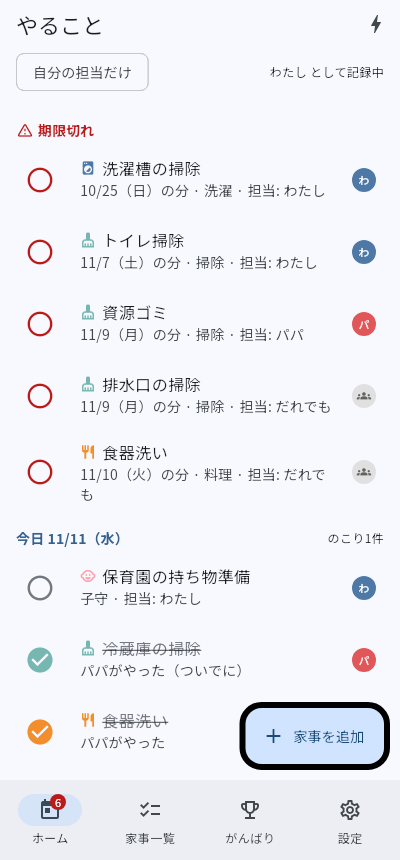
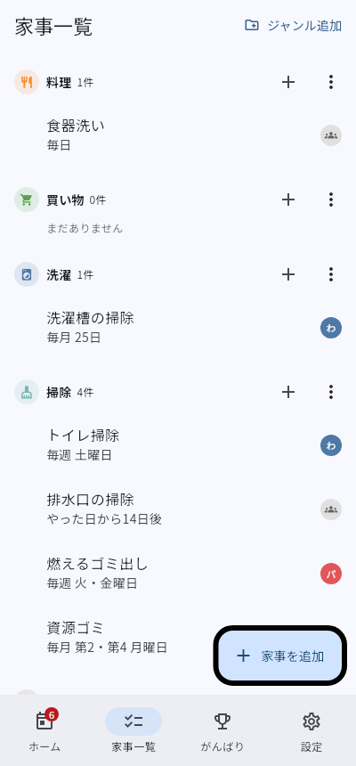
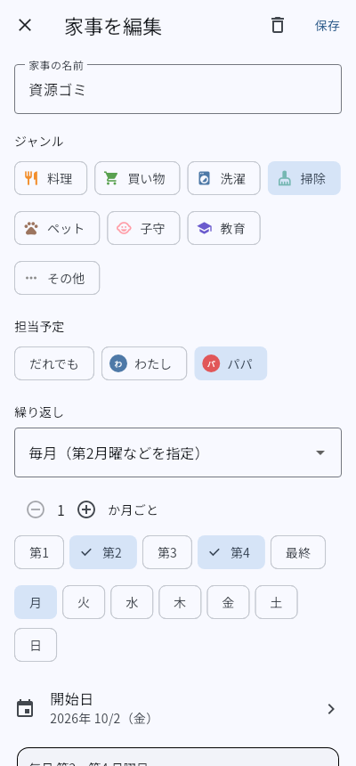
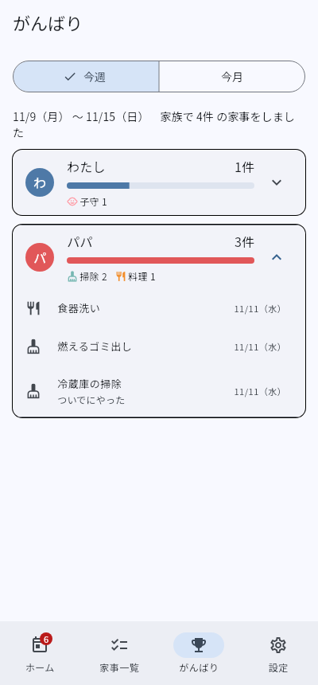

# 家事きろく

家族で「やること」を共有し、「誰が何をやったか」を見える化して褒め合える家事アプリです（iOS / Android、Flutter）。

設計ドキュメント: https://claude.ai/artifact/HxvKnXs46PhTpTzuxFqudQ

## 試作版 0.1 でできること

| 画面 | できること |
| --- | --- |
| ホーム | 期限切れ → 今日 → 明日 … と1週間分のやることを表示。丸をタップで完了、長押しで「実際にやった人」を選ぶ・スキップ・取り消し。⚡ボタンで予定外の「ついでにやった」を記録。下のタブに未完了件数のバッジ |
| 家事一覧 | ジャンルごとの家事と繰り返しルール。ジャンルの追加・名前/アイコン/色の変更・非表示 |
| 家事の登録・編集 | ジャンル、担当予定者、繰り返し（毎日・N日ごと／毎週の曜日／毎月の日にち・月末／毎月 第2・第4月曜など／毎年／やった日からN日後）、開始日、メモ。次の予定日をその場で確認 |
| がんばり | 今週・今月に、誰が何件やったか。ジャンル内訳と、やった家事の一覧 |
| 設定 | 家族メンバーの追加・名前変更、この端末を使う人の切り替え |

試作版では、データは**この端末の中だけ**に保存します。家族のスマホ同士での共有（招待リンク）、通知・リマインド、買い物リストは次の段階で追加します。

| ホーム | 家事一覧 | 登録・編集 | がんばり |
| --- | --- | --- | --- |
|  |  |  |  |

## ブラウザで試す

https://yosihirox.github.io/kaji_kiroku/

PC でもスマホでも開けます。`main` にマージされるたびに、GitHub Actions がテストしてから自動で公開し直します。ブラウザ版のデータはそのブラウザの中だけに保存されます。

初回だけ、リポジトリの **Settings → Pages → Build and deployment → Source** を「GitHub Actions」にしてください。

## 手元で動かす

1. [Flutter をインストール](https://docs.flutter.dev/get-started/install)（最新の安定版）
2. このリポジトリをクローンして、フォルダで次を実行

   ```sh
   flutter pub get
   flutter run
   ```

- **Android**: Windows / Mac のどちらでも OK。Android Studio のエミュレーターか、USB でつないだ実機で動きます。
- **iPhone**: Mac と Xcode が必要です。実機で試すときは Xcode で `ios/Runner.xcworkspace` を開き、Signing に自分の Apple ID を設定します。

## 構成

```
lib/
  main.dart            アプリの起動と下部タブ
  models.dart          メンバー・ジャンル・家事・実施記録
  recurrence.dart      繰り返しルールと日付計算
  store.dart           状態の管理と保存（保存先は差し替え可能）
  ui_common.dart       アイコン・色・共通部品
  screens/             各画面
test/                  繰り返し計算・状態管理・画面のテスト
```

「家事の定義（Chore）」と「毎回の実施記録（Record）」を分けているので、担当予定者と実際にやった人を毎回別々に残せます。

テストは `flutter test` で実行できます。
