# 家事きろく

家族の「やること」と「やったこと」を、みんなで見える化する家事アプリです（iOS / Android / ブラウザ、Flutter）。
誰が何をやったかが残るので、競うのではなく「ありがとう」を伝えやすくなることを目指しています。

- ブラウザで試す: https://yosihirox.github.io/kaji_kiroku/
- 設計ドキュメント: https://claude.ai/artifact/HxvKnXs46PhTpTzuxFqudQ

| ホーム | 完了・やった人 | 買い物 | がんばり |
| --- | --- | --- | --- |
| 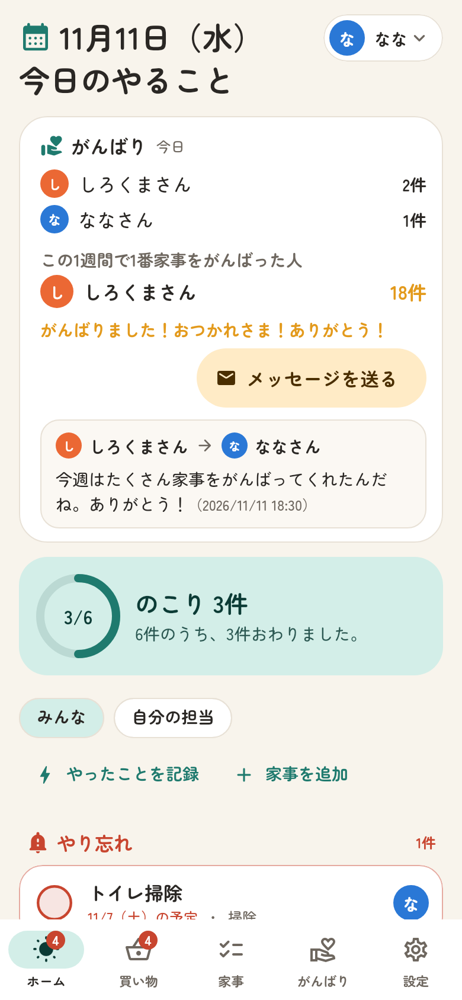 | 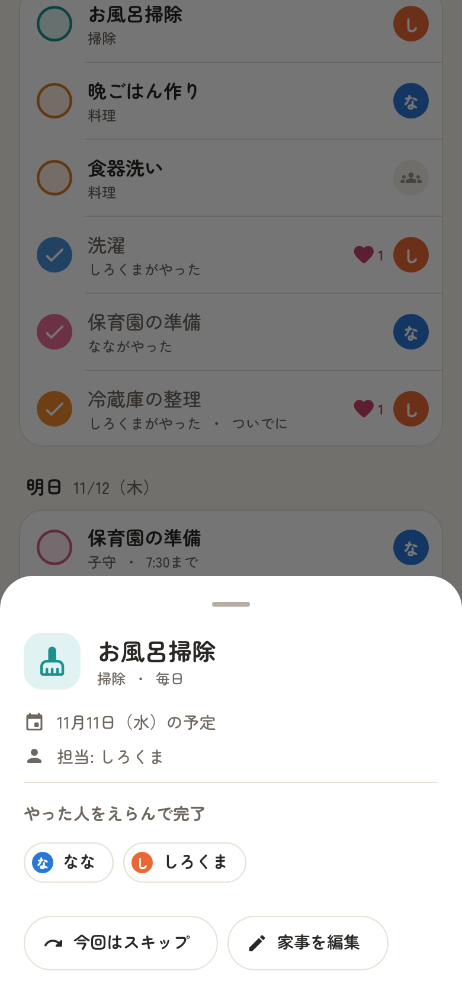 | 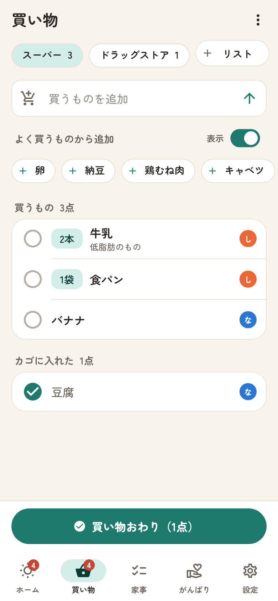 | 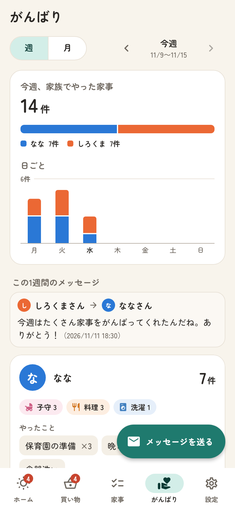 |

| 家事の登録 | くり返し | 通知の設定 | ダークモード |
| --- | --- | --- | --- |
| 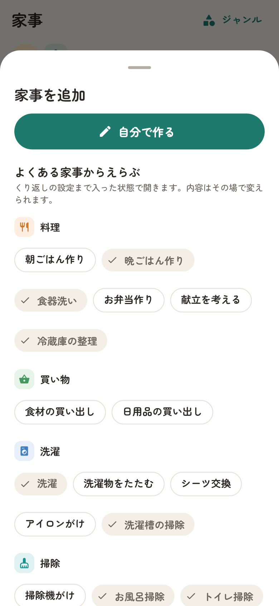 | 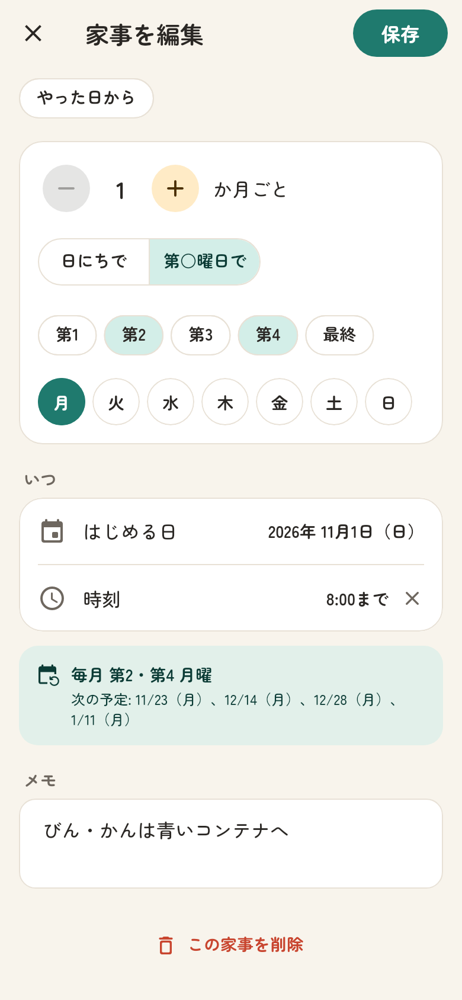 | 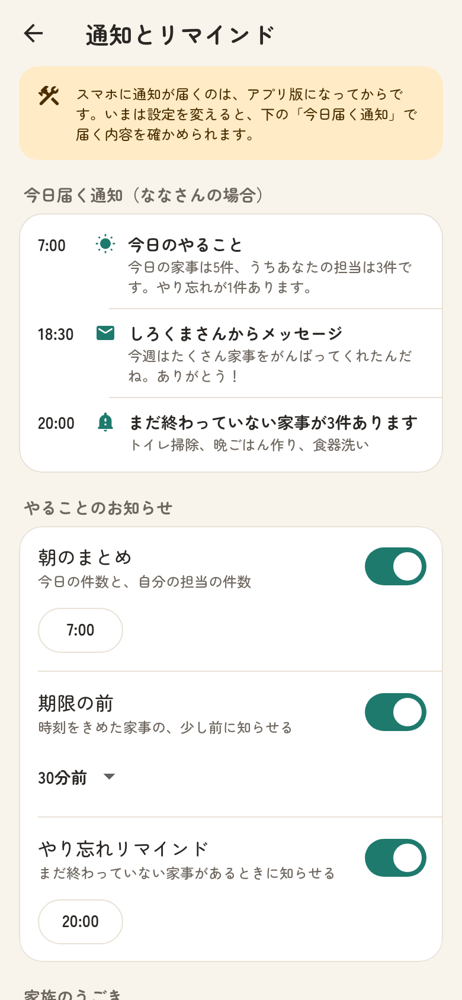 | 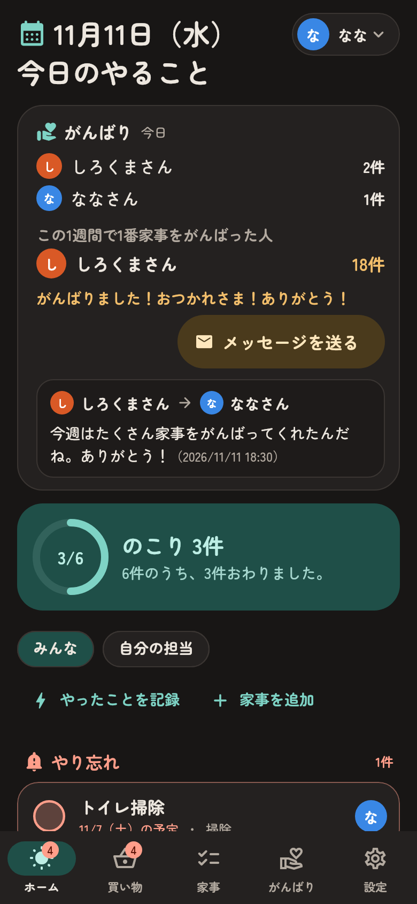 |

## 試作版 0.3 で変わったこと

ななちゃんに使ってもらって出た要望を反映しました。0.2 のデータはそのまま使えます。

| 画面 | 変わったこと |
| --- | --- |
| ホーム | 日付を大きくし、タップするとカレンダーが開く。「決定」でその日の家事をさかのぼって見られる（外をタップすると変えずに閉じる）。日付の下に「がんばり」枠（今日家事をした人と件数、この1週間で1番がんばった人）。家族にメッセージを送れる。「家事を追加」は「やったことを記録」の横へ。「やったことを記録」は、えらんでから「完了」でまとめて記録 |
| メッセージ | 宛先（最初は今日いちばん家事をした人）と本文を入れて送ると、ホームと「がんばり」に1週間出る。送った本人だけ × で消せる。届いたメッセージは通知の対象 |
| 家事 | ジャンルの左の「＋」から、そのジャンルの家事だけをえらんで追加。「自分で作る」はジャンルがえらばれた状態で開く |
| 買い物 | 「よく買うものから追加」の表示・非表示を切り替え。「＋ リスト」はその場で入力（すぐキーボードが出る）。数（1〜10 はタップ、11以上は入力）と単位（個・パック・本 …）をメモと分け、品物の左に表示。左スワイプで「削除」 |
| がんばり | この1週間のメッセージを表示。右下に「メッセージを送る」 |
| お知らせ | 「完了！」「買い出しを記録しました」は3秒で消え、タップやタブの切り替えでも消える |

| ホーム | カレンダー | メッセージ | やったことを記録 |
| --- | --- | --- | --- |
|  | 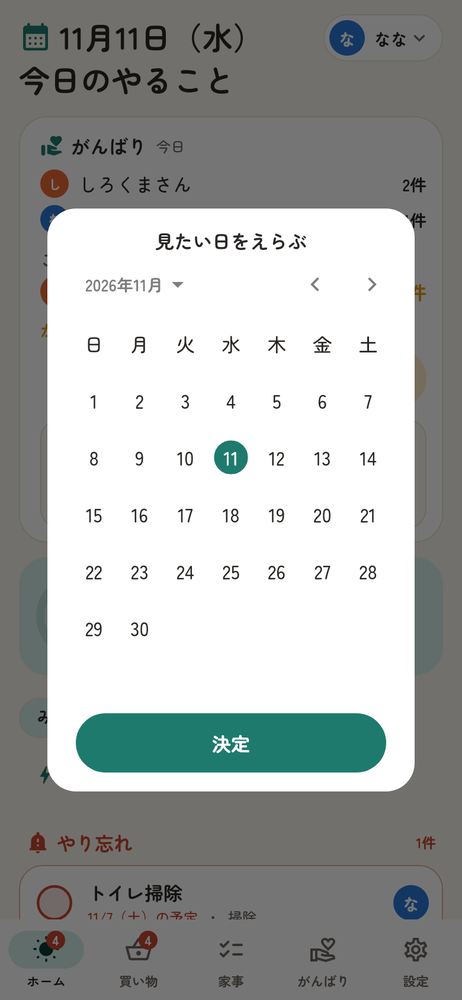 | 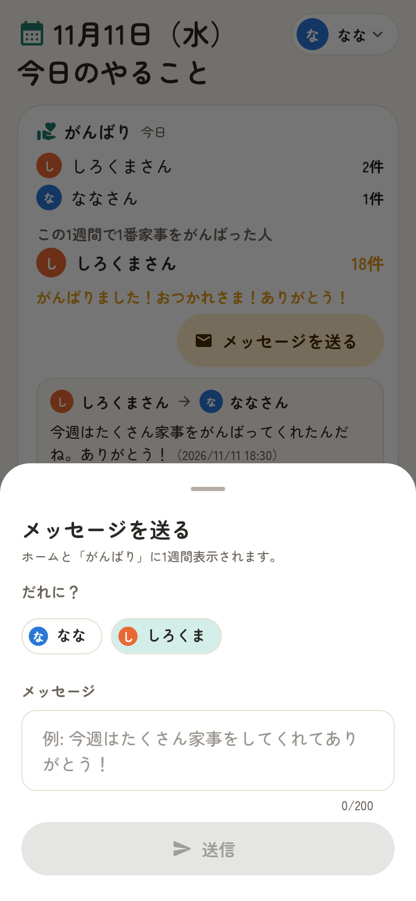 | 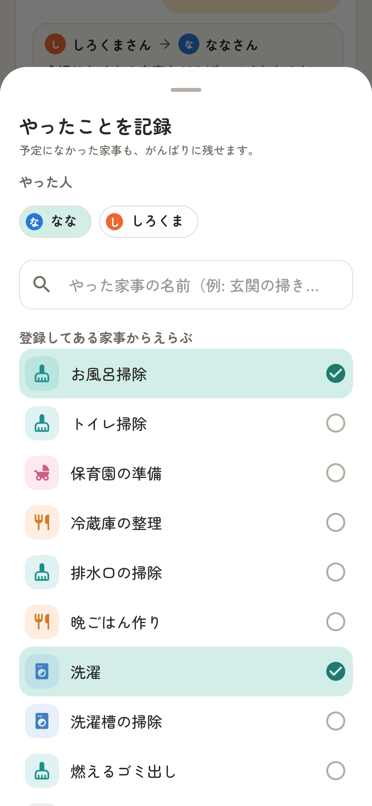 |

| 買い物 | 数と単位 | 左スワイプで削除 | ジャンルから追加 |
| --- | --- | --- | --- |
|  | 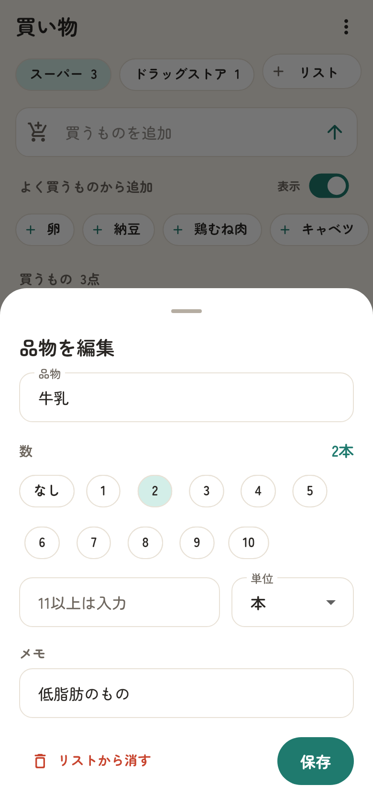 | 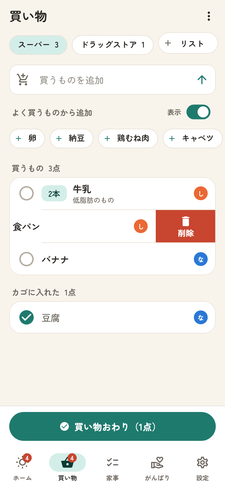 | 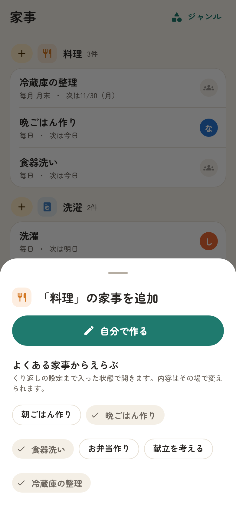 |

## 試作版 0.2 でできること

0.1 を土台から作り直しました。0.1 で入れたデータは、そのまま引き継がれます。

| 画面 | できること |
| --- | --- |
| はじめての設定 | 名前と家族を入れて、よくある家事をえらぶだけで始められる |
| ホーム | やり忘れ → 今日 → 明日 … と1週間分のやることを表示。丸をタップで完了（取り消しもすぐ）。行をタップで「実際にやった人」をえらぶ・スキップ・スタンプ。「やったことを記録」で、予定になかった「ついでにやった」も残せる。「自分の担当」だけに絞り込み。タブに未完了の件数バッジ |
| 買い物 | 家族で共有する買い物リスト（スーパー、ドラッグストアなど複数）。よく買うものからワンタップで追加。カゴに入れたらチェックし、「買い物おわり」で買い出し1件として「がんばり」に記録 |
| 家事 | ジャンルごとの一覧と次の予定日。よくある家事のひな形から、くり返し設定つきで登録 |
| 家事の登録・編集 | ジャンル、担当、くり返し（毎日・N日ごと／毎週の曜日／毎月の日にち・月末／毎月 第2・第4月曜など／毎年／やった日からN日後）、時刻、メモ。次の予定日をその場で確認 |
| がんばり | 週・月ごとに、誰が何をやったか。日ごとのグラフ、ジャンルの内訳、やった家事の一覧。スタンプ（ありがとう・すごい・助かった・おつかれさま）を送れる |
| 設定 | 家族の追加・色の変更、通知とリマインド（朝のまとめ・期限の前・やり忘れ・おやすみ時間・ジャンルごと）、ジャンルの追加と並べ替え、ライト／ダーク、データの書き出しと読み込み |

### まだできないこと

- **家族それぞれのスマホとつなぐこと（招待リンク）**: いまは1台の中に家族みんなの分を記録します。ホーム右上の名前をタップすると、使う人を切り替えられます。
- **スマホへの通知**: 通知の設定と「今日届く通知」の確認まではできますが、実際に届くのはアプリ版になってからです。

データは**この端末（このブラウザ）の中だけ**に保存します。設定の「データを書き出す」で控えを取れます。

## ブラウザで試す

https://yosihirox.github.io/kaji_kiroku/

PC でもスマホでも開けます。スマホでは「ホーム画面に追加」すると、アプリのように全画面で使えます。
`main` にマージされるたびに、GitHub Actions がテストしてから自動で公開し直します。

## 手元で動かす

1. [Flutter をインストール](https://docs.flutter.dev/get-started/install)（最新の安定版）
2. このリポジトリをクローンして、フォルダで次を実行

   ```sh
   flutter pub get
   flutter run
   ```

- **Android**: Windows / Mac のどちらでも OK。Android Studio のエミュレーターか、USB でつないだ実機で動きます。
- **iPhone**: Mac と Xcode が必要です。実機で試すときは Xcode で `ios/Runner.xcworkspace` を開き、Signing に自分の Apple ID を設定します。

## 構成

```
lib/
  main.dart / app.dart   起動、テーマ、画面の切り替え
  domain/                画面に依存しない中身
    recurrence.dart        くり返しルールと日付計算
    models.dart            メンバー・ジャンル・家事・記録・買い物・メッセージ・通知設定
    agenda.dart            「今日やること」と、やり忘れの組み立て
    report.dart            がんばりの集計
    notifications.dart     届く通知の組み立て
    catalog.dart           初期ジャンル、家事のひな形、色
  data/                  保存の形（JSON）と、0.1 からの引き継ぎ
  state/app_store.dart   状態の管理と保存
  ui/                    画面（home / shopping / chores / report / messages / settings / onboarding）
test/                    くり返し・状態管理・通知・画面操作のテスト
tool/                    画面の画像、アイコン、フォントを作り直すスクリプト
```

「家事の定義（Chore）」と「毎回の実施記録（Record）」を分けているので、担当と実際にやった人を毎回別々に残せます。
保存先は `KeyValueStorage` を差し替えるだけで変えられるので、次の段階ではここをクラウド（家族共有）に置き換えます。

## 開発メモ

```sh
flutter analyze --no-fatal-infos
flutter test                              # テスト
flutter test tool/screenshots_test.dart   # docs/screenshots の画像を作り直す
python3 tool/make_icons.py                # アイコンを作り直す（Pillow が必要）
```

- 文字は [Zen Maru Gothic](https://fonts.google.com/specimen/Zen+Maru+Gothic)（SIL Open Font License、`assets/fonts/OFL.txt`）を同梱しています。容量を抑えるため、よく使う文字（JIS 第1水準の漢字とかな・記号）だけに絞っています。絞り直すときは `python3 tool/subset_font.py <元のフォントのフォルダ> assets/fonts`。
- 画面には絵文字を使わず、アイコンで統一しています（どの端末でも同じ見た目にするため）。
